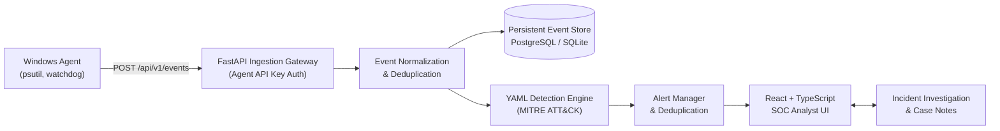

# SentinelEDR

> **Local-First Endpoint Detection & Response (EDR) Platform**  
> *Engineered for Cybersecurity Learning, Detection Engineering, and SOC Analyst Training.*

---

## 🛡️ Overview

**SentinelEDR** is a functional, local-first endpoint security monitoring and threat detection platform. It collects permitted endpoint telemetry from Windows 10/11 endpoints, normalizes security events into structured schemas, evaluates behavioral detection rules written in YAML, maps findings to the MITRE ATT&CK® framework, and provides an analyst dashboard for threat triage and incident investigation.

> [!NOTE]  
> **Educational Prototype:** SentinelEDR is designed for educational demonstrations, blue team labs, and portfolio defense analysis. It is not a replacement for commercial enterprise EDR software and does not perform automated destructive remediation.

---

## 🏗️ Architecture



---

## ✨ Key Features

- **Windows Endpoint Agent (`agent/`):**
  - Monitors process creation lineage (PID, PPID, executable path, command line, user).
  - Inspects active outbound network socket connections (remote IP, port, protocol).
  - Opt-in honeypot directory monitor (`watchdog`) strictly targeting designated test directories without uploading file contents.
  - Persistent SQLite-backed local disk queue (`agent_queue.db`) bounded to 2,000 items for offline buffering.
  - Auto-enrollment using pre-shared enrollment token; receives dedicated revocable agent API key.
- **YAML-Based Detection Engine (`backend/app/detection/`):**
  - Schema-validated YAML rules with multi-attribute conditions and regex matching.
  - 10-minute alert deduplication window to prevent alert flooding.
  - 6 included production-grade detection rules covering execution, evasion, command-and-control, and ransomware honeypot anomalies.
  - Native MITRE ATT&CK® technique and tactic mapping.
- **Alert Triage & Case Management (`backend/app/services/`):**
  - Full alert lifecycle: `New` → `Acknowledged` → `Investigating` → `Resolved` / `False Positive`.
  - False positive tracking with mandatory justification rationale.
  - Incident case management with collaborative timeline notes and multi-alert correlation.
  - Immutable audit trail recording administrative and analyst actions.
- **Modern SOC Analyst Dashboard (`frontend/`):**
  - Professional SOC dark-mode UI built with React 18, TypeScript, Vite, and Tailwind CSS.
  - Real-time telemetry charts and severity breakdown using Recharts.
  - Unmistakable persistent **DEMO DATA** indicator banner.
  - 11 fully functional views: Overview, Endpoints, Event Explorer, Alerts, Alert Details, Incidents, Incident Details, Detection Rules, Audit Logs, Settings.
- **Deterministic Synthetic Demo Generator (`backend/app/demo/`):**
  - One-command seed script (`python -c "..."`) simulating benign baselines and realistic multi-stage spearphishing chains without executing real malware or offensive payloads.

---

## 📁 Repository Structure

```
sentinel-edr/
├── agent/                         # Windows Endpoint Agent
│   ├── sentinel_agent/
│   │   ├── collectors/            # Process, network, file, and system collectors
│   │   ├── config.py              # Configuration validation
│   │   ├── queue.py               # SQLite persistent disk queue
│   │   ├── transport.py           # HTTP client with exponential backoff
│   │   ├── runner.py              # Telemetry loops orchestrator
│   │   └── main.py                # Agent CLI entrypoint
│   ├── tests/                     # Agent collector & queue unit tests
│   ├── config.example.yaml        # Safe agent configuration template
│   └── requirements.txt
├── backend/                       # FastAPI Ingestion & Management Server
│   ├── app/
│   │   ├── api/v1/                # Modular REST API routers
│   │   ├── auth/                  # RBAC, PBKDF2 password hashing & agent auth
│   │   ├── database/              # SQLAlchemy engine & session management
│   │   ├── detection/             # YAML rule parser, evaluator & detection engine
│   │   ├── models/                # SQLAlchemy database models
│   │   ├── schemas/               # Pydantic v2 request/response schemas
│   │   ├── services/              # Business logic & audit logging
│   │   ├── demo/                  # Synthetic demo seeder & reset logic
│   │   └── main.py                # FastAPI application factory
│   ├── migrations/                # Alembic database migrations
│   ├── tests/                     # 31 automated backend tests
│   ├── Dockerfile
│   └── requirements.txt
├── frontend/                      # React + TypeScript + Vite Dashboard
│   ├── src/
│   │   ├── api/                   # API client fetch wrapper
│   │   ├── components/            # Reusable UI components & badges
│   │   ├── context/               # AuthContext state provider
│   │   ├── pages/                 # 11 SOC operations views
│   │   └── types/                 # TypeScript interfaces
│   ├── Dockerfile
│   └── package.json
├── rules/                         # YAML Detection Rules
│   ├── rule_a_suspicious_parent_child.yaml
│   ├── rule_b_script_cli_indicators.yaml
│   ├── rule_c_unusual_execution_context.yaml
│   ├── rule_d_suspicious_network.yaml
│   ├── rule_e_monitored_directory.yaml
│   └── rule_f_agent_health.yaml
├── docs/                          # Comprehensive technical documentation
│   ├── architecture.md
│   ├── detection-engine.md
│   ├── api.md
│   ├── windows-agent-setup.md
│   ├── deployment.md
│   ├── security-model.md
│   ├── troubleshooting.md
│   └── demo-guide.md
├── compose.yaml                   # Containerized stack configuration
├── Makefile                       # Convenient development automation commands
└── .env.example                   # Environment configuration template
```

---

## 🚀 Quickstart Guide (Local Development on Windows)

### 1. Prerequisites
- Python 3.11+
- Node.js v18+ and npm
- Windows 10/11

### 2. Install Dependencies
```powershell
# Install backend and agent dependencies
pip install -r backend/requirements.txt
pip install -r agent/requirements.txt

# Install frontend dependencies
cd frontend
npm install
cd ..
```

### 3. Seed Demo Data & Sync Detection Rules
```powershell
python -c "import sys; sys.path.insert(0, 'backend'); import app.demo.seed; app.demo.seed.main()"
```

### 4. Start the Backend API
```powershell
python -m uvicorn app.main:app --app-dir backend --reload --port 8000 --host 127.0.0.1
```
*API is accessible at `http://127.0.0.1:8000` (OpenAPI docs at `http://127.0.0.1:8000/docs`).*

### 5. Start the Frontend Dashboard
In a second terminal:
```powershell
cd frontend
npm run dev
```
Open `http://localhost:5173` in your browser.

**Default Login Credentials:**
- **Username:** `admin`
- **Password:** `SentinelAdmin!2026Secure`

### 6. (Optional) Run the Windows Endpoint Agent
In a third terminal:
```powershell
python -m sentinel_agent.main --config agent/config.example.yaml
```

---

## 🧪 Running the Automated Test Suite

SentinelEDR includes 31 automated tests covering detection rule matching, alert deduplication, RBAC, agent authentication, and queue bounds:

```powershell
# Run all backend and agent tests
python -m pytest backend/tests agent/tests -v
```

To build the frontend production bundle:
```powershell
cd frontend
npm run build
```

---

## 🐳 Docker Deployment

To launch the full containerized stack (PostgreSQL + FastAPI + Nginx React Frontend):

```powershell
docker compose up --build -d
```
Access the frontend at `http://localhost:3000` and the API at `http://localhost:8000`.

---

## 🔒 Security Model & Privacy Guarantees

- **No Remote Code Execution:** The agent does not execute commands received from the central server.
- **No Keystroke / Password Collection:** Sensitive user data, browser sessions, and cookies are never gathered.
- **No File Content Uploads:** File inspection is restricted exclusively to file paths, extensions, and metadata in explicitly opted-in test folders.
- **Cryptographic Hashing:** Passwords hashed with PBKDF2-HMAC-SHA256 (200,000 iterations). Agent API keys hashed with SHA-256.

---

## 📄 License
Educational use only. Built for cybersecurity analysis and research.
