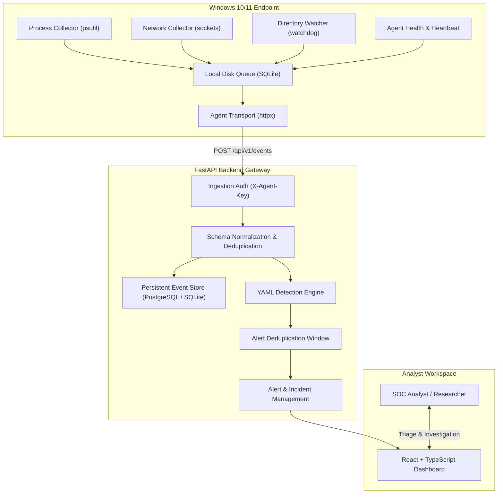

# SentinelEDR Architecture Specification

SentinelEDR is an educational, local-first Endpoint Detection and Response (EDR) platform designed for cybersecurity learning, SOC analyst training, and threat detection prototyping.

## 1. High-Level Data Flow

---

## 2. Component Breakdown

### 2.1 Windows Endpoint Agent (`agent/`)
- **Runtime:** Python 3.11+
- **Telemetry Collection:**
  - `ProcessCollector`: Enumerates running processes, parent PID, command lines, usernames, creation timestamps. Tracks seen instances to emit only newly created processes.
  - `NetworkCollector`: Evaluates outbound IPv4/IPv6 socket connections, maps remote IPs/ports to local processes, filters internal loopbacks.
  - `DirectoryWatcher`: Opt-in filesystem monitor observing created, modified, and deleted metadata in an explicitly configured directory. Does not upload file contents.
  - `SystemCollector`: Gathers non-invasive platform, memory, CPU, and network interface metadata; generates a stable host identifier across restarts.
- **Resilience:**
  - SQLite-backed local disk FIFO queue (`agent_queue.db`) bounded to 2,000 items to buffer telemetry when the API is temporarily unavailable.
  - Exponential backoff retry logic and network timeouts.

### 2.2 Ingestion & API Gateway (`backend/app/api/`)
- **Runtime:** FastAPI, Pydantic v2, SQLAlchemy 2.0
- **Security:**
  - Strict separation of agent API credentials (`X-Agent-Key`) from analyst credentials (`Bearer JWT`).
  - Cross-host spoofing prevention: agent keys can only submit events matching their enrolled host ID.
  - Bounded batch ingestion limits (100 events per request) to prevent memory exhaustion.

### 2.3 YAML Detection Engine (`backend/app/detection/`)
- **Rule Parser:** Validates YAML detection rules with strict Pydantic schemas.
- **Evaluation Logic:** Evaluates conditions (`equals`, `in`, `contains`, `matches_any_substring`, `matches_regex`, `not_in_cidr_or_local`, `greater_than`).
- **Alert Deduplication:** Repeated detection triggers on the same host within a 10-minute window increment event count rather than creating alert flood duplicates.
- **MITRE ATT&CK Mapping:** Links every rule and resulting alert to valid ATT&CK technique IDs and tactics.

### 2.4 Incident Investigation & Case Management (`backend/app/services/`)
- **Status Lifecycle:** `Open` → `Investigating` → `Contained` → `Resolved` → `Closed`.
- **Collaborative Notes:** Append-only timeline notes recording analyst observations, containment commands, and forensic hypotheses.
- **Alert Association:** Supports grouping multiple related alerts into a single cohesive incident case.

### 2.5 SOC Analyst Dashboard (`frontend/`)
- **Runtime:** React 18, TypeScript, Vite, Tailwind CSS, Recharts.
- **Design System:** Restrained, accessible cybersecurity SOC dark theme.
- **Persistent Indicators:** Persistent `DEMO MODE` banner when simulated synthetic data is loaded.
